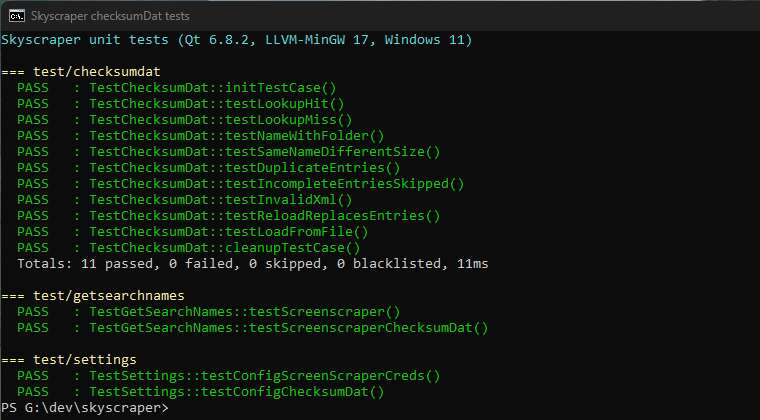
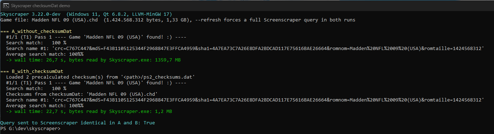

# Fork rsporteman/skyscraper

> **English summary:** personal fork of [Gemba/skyscraper](https://github.com/Gemba/skyscraper).
> It adds the `checksumDat=` option, which reads the CRC32/MD5/SHA1 that Screenscraper needs from a
> Logiqx XML DAT instead of reading each game file. Branch `feat_checksum_dat` holds the change as
> it was proposed upstream. This file documents the change, the Windows build and the validation.
> Licensed under GPL-3.0 like upstream, see [License](#licença).

Este fork existe para uma mudança só, que também foi proposta ao projeto original:

| Branch | O que tem |
|---|---|
| `master` | Igual ao `master` do [Gemba/skyscraper](https://github.com/Gemba/skyscraper) |
| `feat_checksum_dat` | A mudança, num commit só, como foi enviada no PR ao projeto original |
| `fork-notas` | `feat_checksum_dat` mais este arquivo e as imagens em `docs/fork/` |

## O problema

Para identificar um jogo, o ScreenScraper recebe o CRC32, o MD5 e o SHA1 do arquivo do jogo. Até
agora o Skyscraper lia o arquivo inteiro, sempre, para calcular esses três valores. Com imagens
grandes (CHD ou ISO de vários GB) isso fica lento; em disco lento fica muito lento:

| Situação (mesmo PC, CHD de PS2 de ~1,5 GB) | Tempo só para os hashes |
|---|---|
| Skyscraper no WSL lendo o `G:` do Windows (`/mnt/g`) | ~2,5 min por jogo (lê de 1 KB em 1 KB, ~8 MB/s) |
| Skyscraper nativo no Windows, disco local | ~10 s por jogo |
| Com `checksumDat` | nada é lido |

Num acervo de 574 jogos de PS2, só os hashes no WSL somavam cerca de 20 horas.

## A mudança

Nova opção do `config.ini`, nas seções `[main]` e `[<PLATAFORMA>]`:

```ini
[ps2]
checksumDat="G:/ROMs/_organizacao/skyscraper/ps2_checksums.dat"
```

O valor é o caminho absoluto de um DAT no formato Logiqx XML, o mesmo do No-Intro, do Redump, do
ClrMamePro e do RomVault:

```xml
<datafile>
  <game name="Madden NFL 09 (USA)">
    <rom name="Madden NFL 09 (USA).chd" size="1424568312" crc="C767C447"
         md5="F43B1105125344F2968847E3FFCA4959" sha1="4A7EA73C7A26E8DFA2BDCAD117E75616BAE26664"/>
  </game>
</datafile>
```

Regras:

- Um arquivo casa com um `<rom/>` quando o **nome do arquivo** (sem pasta) e o **tamanho em bytes**
  são iguais. Aí os hashes do DAT são usados e o arquivo não é lido.
- Entradas sem `size`, `crc`, `md5` ou `sha1` válidos são ignoradas, e o total delas é informado.
- Mesmo nome e tamanho com hashes diferentes é ambíguo: o Skyscraper calcula os hashes como antes.
- Sem entrada no DAT, ou com o tamanho diferente (arquivo mudou), também calcula como antes.
- Só vale para o módulo `screenscraper`. Nos outros, a opção é ignorada com um aviso.

Arquivos alterados:

| Arquivo | Mudança |
|---|---|
| `src/checksumdat.h/.cpp` | Classe nova `ChecksumDat`: lê o DAT (`QXmlStreamReader`) e busca por nome e tamanho |
| `src/screenscraper.cpp/.h` | `getSearchNames()` usa o DAT; o cálculo antigo foi para `computeChecksums()` sem mudanças |
| `src/settings.cpp/.h` | Opção `checksumDat`, validada como o `scummIni` (caminho absoluto, arquivo existe) |
| `src/skyscraper.cpp/.h` | `loadChecksumDat()` carrega o DAT antes da raspagem |
| `docs/CONFIGINI.md`, `config.ini.example` | Documentação da opção |
| `test/checksumdat/` (novo), `test/getsearchnames/`, `test/settings/` | Testes |

## Testes

| Suíte | Casos novos |
|---|---|
| `test/checksumdat` | acerto por nome e tamanho, hex em maiúsculas; tamanho diferente, nome desconhecido e caixa diferente não casam; nome com pasta (`/` e `\`); mesmo nome com tamanhos diferentes; duplicatas iguais (inclusive só na caixa) e ambíguas; 6 tipos de entrada incompleta; XML inválido; recarregar limpa o anterior; ler de arquivo e arquivo inexistente |
| `test/getsearchnames` | a consulta ao ScreenScraper usa os hashes do DAT (valores falsos de propósito, para provar que o arquivo não foi lido); arquivo de 0 byte; tamanho diferente e DAT vazio voltam a calcular |
| `test/settings` | `checksumDat` em `[main]`, sobreposto por `[<PLATAFORMA>]`, arquivo inexistente e caminho relativo dão erro |



No Windows, `test/pathtools`, `test/retroarch` e `test/settings` têm 6 falhas que **já existem no
`master` original**: são testes que esperam `/` e recebem `\`. Conferi rodando o `master` sem a
mudança. O CI do projeto original roda os testes no Linux.

## Validação com jogos reais

Mesmo jogo, raspado duas vezes com `--refresh` (consulta completa ao ScreenScraper nas duas):



- A consulta enviada ao ScreenScraper é **idêntica** nas duas execuções (o mesmo CRC, MD5, SHA1,
  nome e tamanho), e o jogo foi achado com 100% nas duas.
- Sem o DAT, o `Skyscraper.exe` leu 1.360 MB (o CHD inteiro); com o DAT, 1,2 MB.
- A diferença de tempo aqui é pequena porque o arquivo já estava no cache de disco do Windows; o
  ganho de tempo aparece em disco frio, rede ou WSL (tabela acima).

## Como compilar no Windows

Igual a `win32/README.md` do projeto, trocando o instalador da Qt pelo
[aqtinstall](https://github.com/miurahr/aqtinstall), que não pede conta:

```powershell
python -m pip install --user aqtinstall
python -m aqt install-qt windows desktop 6.8.2 win64_llvm_mingw --outputdir C:\Qt
python -m aqt install-tool windows desktop tools_llvm_mingw1706 --outputdir C:\Qt
$env:PATH = "C:\Qt\6.8.2\llvm-mingw_64\bin;C:\Qt\Tools\llvm-mingw1706_64\bin;$env:PATH"
mkdir build; cd build
qmake ..\skyscraper.pro
mingw32-make -j8
```

Detalhes:

- O passo pós-build que copia as licenças da Qt de `C:\Qt\Licenses` falha com o aqtinstall, porque
  essa pasta só vem no instalador oficial. O `Skyscraper.exe` fica pronto mesmo assim; rode à mão
  os dois passos seguintes: `windeployqt6 release\Skyscraper.exe` e
  `win32\deploy_mandatory_files.ps1 <repo> $env:USERPROFILE\.skyscraper`.
- Os testes compilam com `qmake test_<nome>.pro -after "VERSION=3.22.0.999"`, porque o compilador
  de recursos do Windows não aceita o `-dev` da versão (o `win32/skyscraper.pro` faz o mesmo).
- Rode o `Skyscraper.exe` com a entrada padrão redirecionada quando for de um script; sem isso ele
  pode ficar esperando.

## Gerar o DAT dos seus arquivos

Se os arquivos são dumps verificados sem conversão, o DAT do grupo (Redump, No-Intro) já serve. Se
você converteu para CHD ou compactou, precisa de um DAT com os hashes dos arquivos **atuais**:
qualquer gerenciador de ROMs gera um, ou anote os hashes na hora da conversão. Aqui foi usado um
script em PowerShell que lê cada arquivo uma vez, a 4 MB por leitura, e calcula os três hashes
juntos.

## Licença

O Skyscraper é software livre sob a **GNU General Public License v3.0**, e este fork também
([LICENSE](LICENSE)). Os arquivos novos (`src/checksumdat.*`, `test/checksumdat/*`) têm o mesmo
cabeçalho GPL-3.0-or-later dos arquivos do projeto. Os direitos autorais do código original
continuam de Lars Muldjord, Gemba e demais contribuidores.

Binários para Windows incluem DLLs da Qt, que é LGPL-3.0: quem redistribuir o `Skyscraper.exe` deve
mandar junto as licenças da Qt (`LICENSE` e `LICENSE.GPL3-EXCEPT` da instalação da Qt) e o código-fonte
correspondente. Este fork não publica binários.
